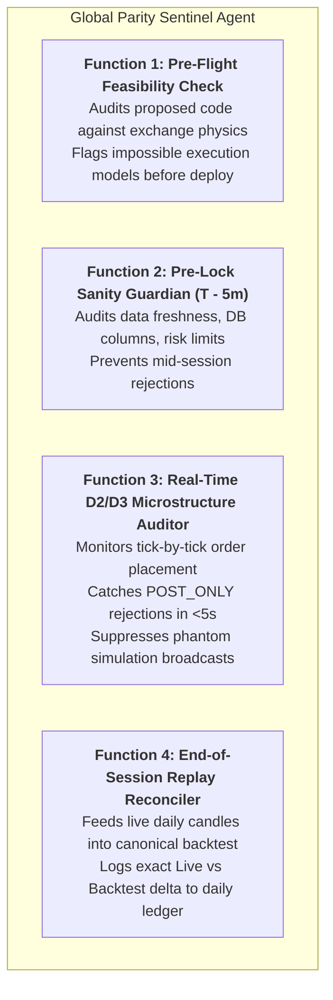

# GLOBAL PARITY SENTINEL SPECIFICATION (G-PSA)
## The Master Cross-System Verification Agent for Backtest-to-Live Reality Parity

**Status:** APPROVED & BINDING (Andy Directive, 2026-11-13)  
**Agent Role:** Global Temporal & Execution Parity Auditor (Standing Supervisor)  
**Scope:** Universal across all trading desks: Crypto Desk (Bitunix BTC/ETH/SOL) · CME Futures Desk (Tradovate/MFFU MNQ/MES) · Alt Matrix · MetaSignals  
**Operating Repositories:** `Kabroda AI Brain` (Theoretical Expectancy / CANON) · `KTBB_app_v2` (Live Production Engine)  
**Core Mandate:** Eradicate the divergence between backtest mathematical theory and live market execution physics. When software tries to execute an impossible order or an unrealistic assumption, the Sentinel halts and flags the divergence before money is lost or trades are missed.

---

## 1. The Architectural Mandate: Why This Agent Exists

Every failure over the past 48 hours occurred because the system lacked an agent with **global dual-vision**:
1. **The Backtest World (Idealized Math):** Assumes 100% instant touch-fills at the trigger price with 0ms latency, zero order-book slippage, and frictionless indicator evaluations.
2. **The Live World (Exchange Physics):** Real exchanges operate with order books, maker vs. taker fee rules, `POST_ONLY` rejections, liquidity gaps, WebSocket polling jitter, and database constraints.
3. **The Software Gap:** Claude Code and human developers write code intended to match the backtest, but introduce fatal execution assumptions:
   - Waiting 5 minutes for a candle close, then attempting to place a maker `POST_ONLY` limit order at a stale price that already broke down.
   - Adding latching semantics to trade-management indicators that inadvertently freeze re-arm clearance for the entire 24-hour day.
   - Adding defensive risk guards in code while forgetting to seed the required parameter (`trailing_drawdown_limit_usd`) in the live database.

**The Sentinel’s Role:** A dedicated, standing global auditor that understands the full scope of both worlds. It continuously evaluates live code and live market microstructure against backtest rules to answer the single vital question:
> *"Can this theoretical backtest rule actually be physically executed on the live exchange order book under current market conditions?"*

---

## 2. The Four Continuous Functions of the Global Sentinel

### Function 1: Pre-Flight Feasibility & Code Audit
Before any code modifying execution, indicators, or order placement is merged or deployed:
- **Exchange Physics Evaluation:** Does the code assume maker execution on a price that has already broken out?
- **Indicator Latch Audit:** Does a state check (like C5 or BBWP) use a historical latch when it should evaluate current bar clearance?
- **Database Dependency Audit:** Does new logic require account fields (e.g., trailing drawdown, high-water mark, multiplier) that exist in schema but are unpopulated in production rows?

### Function 2: Pre-Lock Sanity Guardian (T - 5 Minutes Before Session Lock)
Automated verification run at:
- `13:55 UTC` for Bitcoin / Crypto Desk (ahead of 14:00 UTC lock).
- `14:55 UTC` for CME MNQ & MES Desk (ahead of 15:00 UTC / 10:00 AM ET lock).
- **Checks:**
  1. Candle feed latency (< 120s from wall-clock).
  2. Account credentials valid on Bitunix / Tradovate.
  3. Risk parameters seeded: `trailing_drawdown_limit_usd` is NOT NULL on all active prop accounts.
  4. Kill-switch status and balance checks verified.

### Function 3: Real-Time D2 / D3 Microstructure Auditor (Post-Trigger)
- The instant a trigger crosses:
  1. Inspects the exchange order response within 5 seconds.
  2. If the order is rejected (e.g. Bitunix `POST_ONLY` cancel / `IOC` dropped), immediately tags `EXECUTION_DESYNC`, records the order book depth at that second, and **halts all downstream simulation emails/broadcasts**.
  3. Confirms exchange-side brackets: verifies that Stop Loss and Take Profit orders physically exist on the exchange matching engine.
  4. Verifies Re-Arm watch state: ensures `exhaustion_cleared` is evaluated exclusively on the latest confirmed bar, preventing permanent latch lockouts.

### Function 4: End-of-Session Replay Reconciler (Daily Post-Close)
- At the end of each session window:
  1. Ingests the exact completed 5m and 1H candles from the live day.
  2. Runs them through the standalone frozen backtest scripts (`replay_v3_5yr.py` for Crypto, CME replay for Futures).
  3. Compares:
     $$\Delta R = \text{Realized Live R} - \text{Expected Backtest R}$$
  4. If $|\Delta R| > \text{Tolerance}$ (e.g. slippage, missed fill, premature exit), writes a structured audit finding to `daily_audit_log` detailing:
     - Exact timestamp and candle index where divergence occurred.
     - Root cause: (A) Exchange rejection, (B) Code implementation bug, or (C) Backtest unmodeled microstructure constraint.

---

## 3. Universal Desk Coverage

The Global Sentinel enforces the identical discipline across all four platforms:

| Trading Desk | Target Venue | Primary Invariants Enforced |
| :--- | :--- | :--- |
| **Crypto Desk (BTC/USDT)** | Bitunix Perpetuals | 30m Box Reachability ($\le 0.55$), D2 maker vs taker execution, C5 1H/4H momentum decay, R1 Re-Arm clearance. |
| **CME Desk (MNQ / MES)** | Tradovate / MFFU ($50k) | Value Area Breakout ($BO/BD$), atomic OSO bracket placement, $2,500 trailing drawdown buffer, early-close flattening. |
| **Alt Matrix Desk (SOL / ETH)** | Bitunix Perpetuals | 4H Swing Trend + Momentum filters, isolated margin leverage verification, cross-asset risk caps. |
| **MetaSignals** | Paper / Live Webhook | Signal schema validation, webhook latency, execution slippage tracking. |

---

## 4. The Standing Decision Protocol: What Happens When Divergence Occurs

When the Sentinel discovers that live market behavior cannot match the backtest assumption (e.g. today's POST_ONLY cancellation on breakout):
1. **Never Silently Paper Over:** It does not allow dry-run simulations to pretend a fill occurred when real money failed.
2. **Classify the Root Cause:**
   - **Type A (Pure Code Bug):** e.g. unseeded database column, or indicator latch evaluating historical bars instead of latest bar. -> **Action:** Fix code immediately.
   - **Type B (Physical Execution Friction):** e.g. price broke down fast, taker execution required instead of maker limit. -> **Action:** Sentinel quantifies the fee impact (e.g. 5bp taker fee = -0.05R drag) and presents the mathematical trade-off to Andy: *Do we accept taker execution on entry to capture the +1.418R move, or keep maker limits and accept an X% miss rate?*
3. **Audit Evidence Logging:** All findings committed with backing CSVs and logs to `brain/audit_evidence/parity_sentinel/`.

---

*Authored by Antigravity / DeepSeek. Binding on all subsequent agent sessions and Claude Code implementations.*
