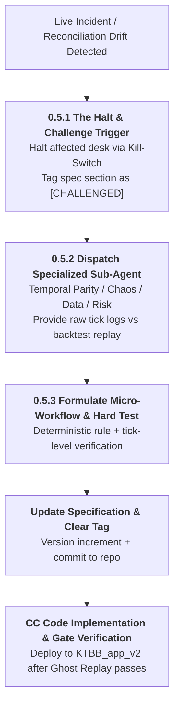
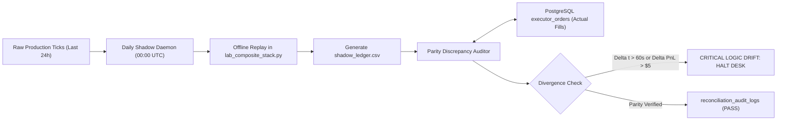
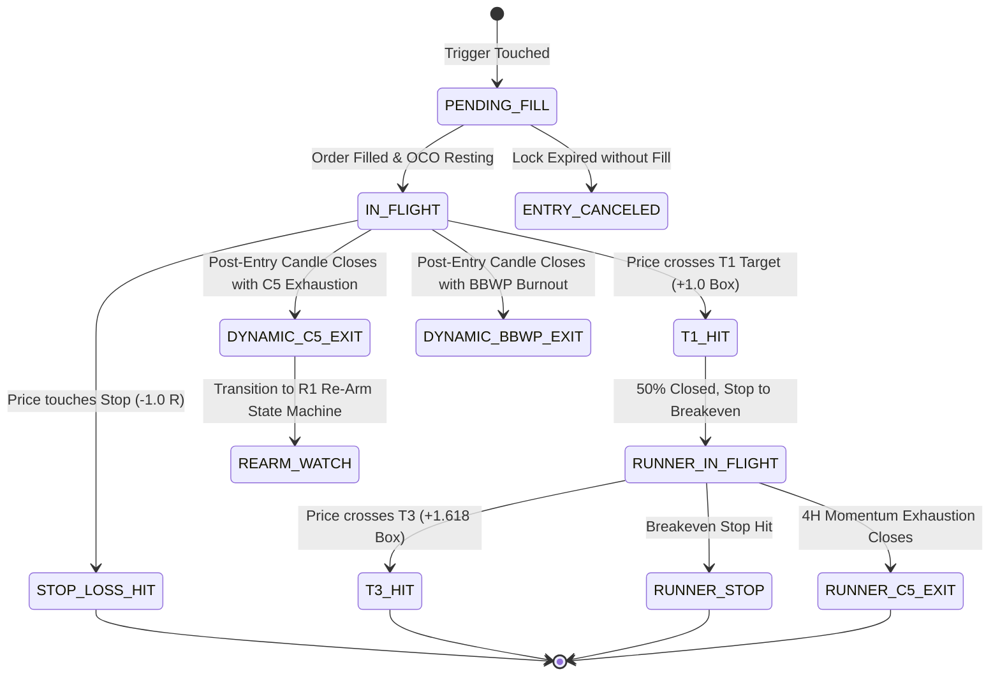
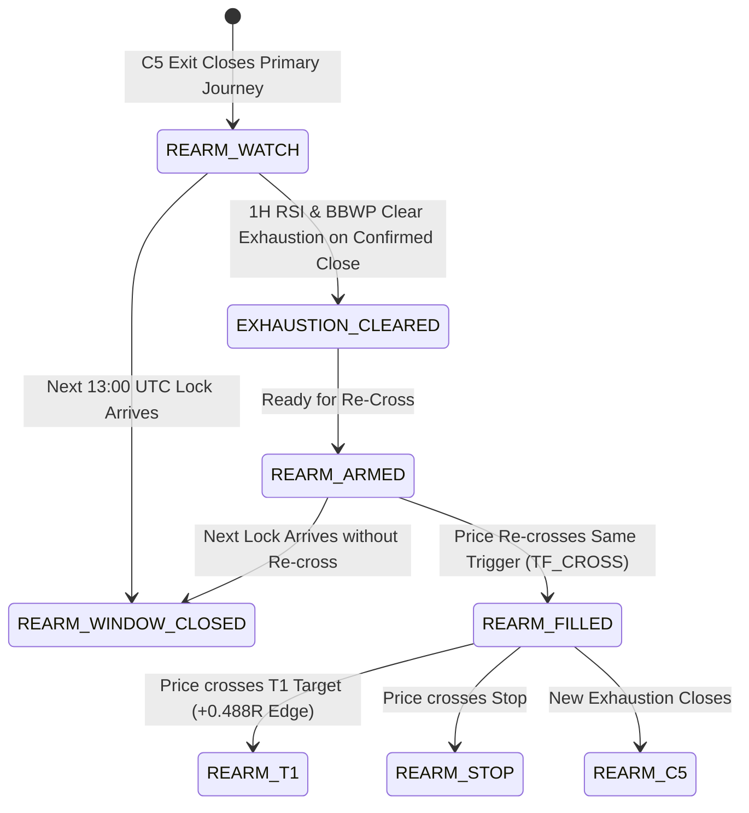
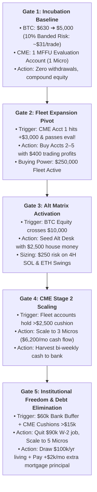

# Kabroda Enterprise Trading Platform - Master Engineering Specification v3.2 (Recursive Core Engineer Edition)
## Autonomous Multi-Desk Architecture, Deterministic State Machines, & Recursive Self-Auditing Protocols

**Document Type:** Master Engineering, Systems Architecture, Data Provenance, Testing, Operations, and **Recursive Expansion** Specification  
**Architecture:** Event-Driven State Machine • Multi-Desk Algorithmic Execution • Parity-Enforced Quantitative Engine  
**Target Environments:** Bitunix Crypto Derivatives (Perpetuals) · CME TradFi Futures (MyFundedFutures / Tradovate / CrossTrade) · High-Yield Altcoin Swings  
**Authoritative Repositories:** `Kabroda AI Brain` (R&D, Calibration, Multi-Agent System) · `KTBB_app_v2` (Live Deterministic Execution Engine)  
**Primary Design Rule:** The live execution environment must operate under the exact same physical and temporal laws as the backtest environment. State is exclusively managed by the database. Execution is strictly idempotent. AI reasoning is strictly isolated from deterministic trade execution. **The backtest is invalid until proven to simulate live constraints.**

---

# 0. Document Purpose & The "Living Constitution" Rule

This document is not static documentation; it is a **recursive, challenge-driven engineering constitution**. It is designed to survive contact with market reality by treating every bug, operational discrepancy, or divergence between live trading and backtesting as a systemic failure requiring immediate specification expansion.

### Reading & Auditing Order (Binding Sequence)
1. **Section 0.5:** Challenge, Expansion & Sub-Agent Protocols (The operational rules of engagement).
2. **Sections 1–3:** Parity, Resilience, Reconciliation & Backtest Reality Audits.
3. **Sections 6–9:** Micro-Workflows for Discovery, Entry, In-Flight Management, and the R1 Re-Arm State Machine.
4. **Section 10:** Empirical Foundations & The CANON Registry.
5. **Section 20:** Appendix of Open Challenges & Active Sub-Agent Investigations.

---

# 0.5. Challenge, Expansion & Sub-Agent Protocol

When a live incident, reconciliation drift, or design contradiction is discovered (e.g., a 45-second premature exit, or a sub-component conflict), the engineering team and AI agents must **never** apply an ad-hoc code patch. They must update and patch this master specification first.



### 0.5.1 The "Halt & Challenge" Trigger
If Live results $\neq$ Backtest results (e.g., timing mismatch, premature exit, unexpected loss, or false entry):
1. **HALT** the affected desk immediately via the emergency kill switch or database status flag.
2. **TAG** the relevant section of this document as `[CHALLENGED]`.
3. **ACTIVATE** the appropriate AI Sub-Agent from the roster below with a precise research brief containing production database logs, exchange fill records, and tick-level backtest replays.

### 0.5.2 AI Sub-Agent Roster & Responsibilities
These specialized AI personas are invoked to research, audit, and expand the platform architecture:
* **Temporal Parity Agent:** Audits candle construction, WebSocket latency, bar-boundary closing rules, and lookahead bias. Triggers when entry/exit timestamps or indicator timings diverge between live and backtest.
* **Chaos & Infrastructure Agent:** Audits database transaction atomicity, race conditions, server reboots, API rate limits, and idempotency constraints. Triggers when orders double-fire, states desynchronize, or processes crash mid-trade.
* **Data Provenance Agent:** Audits exchange API discrepancies, funding rate distortions, order book depth gaps, and historical REST candle stitching. Triggers when indicator warm-ups or tick arrays show discontinuity.
* **Capital & Risk Agent:** Audits the capital ledger, margin requirements, banded risk allocation, trailing drawdown distance, and liquidation constraints. Triggers when sizing diverges or account cushions breach risk limits.

### 0.5.3 Recursive Expansion Workflow
Once a Sub-Agent diagnoses a root cause:
1. Formulate a **Micro-Workflow** that deterministically prevents the exact failure mode.
2. Define a **Hard Verification Test** (e.g., tick-level historical replay against raw exchange candles).
3. Append the new workflow and verification test to the relevant section of this specification.
4. Clear the `[CHALLENGED]` tag, bump the specification version, and commit to Git.
5. Claude Code implements the verified logic in `KTBB_app_v2`, holding live deployment until the 30-day Ghost Replay passes.

---

# 1. Executive Architecture & Mission Statement

Kabroda is a multi-desk algorithmic trading and wealth-compounding institution designed to achieve high-Sharpe, asymmetric capital growth while maintaining deterministic downside protection.

The platform enforces **Zero Logic Drift**: The system mathematically guarantees that an empirical edge verified in the multi-year backtest is executed identically in production, surviving network partitions, API rate limits, server reboots, and webhook duplications without human emotional interference.

```text
┌─────────────────────────────────────────────────────────────────────────────┐
│                       5. AI ADVISORY & REASONING LAYER                      │
│      (Macro Agent, Market Regime Arbiter, Post-Trade Quantitative Auditor)  │
└──────────────────────────────────────┬──────────────────────────────────────┘
                                       │ Advisory / RAG Insights Only (Read-Only)
                                       ▼
┌─────────────────────────────────────────────────────────────────────────────┐
│                    4. USER INTERFACE & MOBILE TELEMETRY                     │
│         (Desktop Web Dashboard, Executive Mobile PWA, Slack Gateway)        │
└──────────────────────────────────────┬──────────────────────────────────────┘
                                       │ Configuration / Emergency Kill Switch
                                       ▼
┌─────────────────────────────────────────────────────────────────────────────┐
│                 3. DETERMINISTIC RISK & SIZING STATE MACHINE                │
│    (Banded Risk Tiering, F_A Regime Multipliers, EOD Trailing Drawdowns)    │
└──────────────────────────────────────┬──────────────────────────────────────┘
                                       │ Gated Execution Plans (PostgreSQL Truth)
                                       ▼
┌─────────────────────────────────────────────────────────────────────────────┐
│                 2. TEMPORAL DATA ENGINE & PARITY LAYER                      │
│   (Event-Driven Clock, Confirmed-Closes Filter, WebSocket/REST Stitching)   │
└──────────────────────────────────────┬──────────────────────────────────────┘
                                       │ Verified Boundary Closes
                                       ▼
┌─────────────────────────────────────────────────────────────────────────────┐
│                 1. BROKER & EXCHANGE TRANSPORT ADAPTERS                     │
│    (Idempotent API Layer, Atomic OCO Order Delegation, Rehydration)         │
└─────────────────────────────────────────────────────────────────────────────┘
```

## 1.1 The 5-Layer Separation of Concerns
1. **Layer 1: Exchange Transport (Idempotent API Layer):** Dispatches trades with unique deterministic UUIDs. Delegates position risk management to exchange-native OCO (One-Cancels-the-Other) or conditional reduce-only orders so trade protection survives server death.
2. **Layer 2: Temporal Data Engine (The Parity Layer):** Enforces strict bar-boundary rules. Stitches historical REST data with live WebSocket feeds to guarantee zero-gap indicator warm-ups. Locks indicator computation strictly to completed candle boundaries (`is_closed=True`).
3. **Layer 3: Deterministic State Machine (The Gating & In-Flight Layer):** Uses PostgreSQL (`ktbb-postgres`) as the single source of truth. Handles setup discovery, dynamic sizing, and position lifecycle rehydration. AI models are strictly barred from altering parameters.
4. **Layer 4: Automated Reconciliation Subsystem (The Self-Audit Engine):** A scheduled daemon that replays raw production market ticks against the canonical offline backtest engine (`lab_composite_stack.py`) to mathematically verify zero temporal or logic divergence.
5. **Layer 5: AI Advisory Layer (MAS):** Fully isolated read-only agents providing macroeconomic situational awareness, variance auditing, and natural-language Slack digests.

---

# 2. Institutional Engineering Standards & Failure Resilience

To prevent cascading failures, execution leakage, and logic drift, the platform enforces strict structural boundaries and deterministic micro-workflows:

### 2.1 The "Zero Drift" Temporal Parity Mandate
The most critical vulnerability in retail algorithmic trading is **temporal schizophrenia**: the live engine evaluates live, in-progress ticks, while the backtest evaluates completed bar closes.
* **Backtest Reality:** Time moves in discrete intervals. An indicator cannot evaluate a 1-Hour condition until `minute == 0` of the completed hour.
* **Live Parity Enforcement:** The live engine is **locked** from evaluating technical indicators (RSI, BBWP, Kinematics) on raw tick data. It utilizes an event-driven `Clock`. Indicators are calculated *strictly* on the array of `confirmed_closes()` only when the exchange broadcasts the `is_closed=True` payload for that specific timeframe.
* **Micro-Workflow (Bar Close Verification):**
  1. Receive `kline` tick payload from WebSocket.
  2. If `is_closed == False`, append tick to real-time price cache; **DO NOT** trigger indicator re-calculation.
  3. If `is_closed == True`, lock the tick buffer, append finalized candle to database `candle_history`, recompute indicators across confirmed bars, and evaluate state transitions.

### 2.2 Idempotency & Race Condition Prevention
* **Deterministic UUID Enforcement:** Every generated signal creates a deterministic UUID based on setup attributes:
  $$\text{Signal UUID} = \text{UUID5}(\text{Namespace}, \text{f"{source}-{symbol}-{direction}-{signal\_timestamp}"})$$
* **Database Constraint:** The `executor_orders` table enforces a `UNIQUE(order_uuid)` and `UNIQUE(traveler_plan_id, account_id, is_rearm)` constraint.
* **Micro-Workflow (The Fill Race Condition):**
  * *Scenario:* Entry fills, but the OCO (Stop/Target) placement API call times out or network drops.
  * *Resolution:* The state machine polls the exchange for open positions lacking linked OCOs every 5 seconds. If found, it immediately dispatches the OCO using a deterministic `OCO-UUID`. If the exchange rejects as duplicate, state is synced. If accepted, safety is restored.

### 2.3 The "Server on Fire" State Rehydration
Assume the Render FastAPI container will crash or reboot the exact millisecond an order is placed.
* **No In-Memory Risk:** The system never holds a Stop-Loss or Target solely in Python RAM or an active coroutine loop.
* **Atomic OCO Exchange Delegation:** The instant an entry fills, the system dispatches an atomic exchange-side Stop-Loss + Reduce-Only Limit Target (OCO) to the broker book.
* **Micro-Workflow (Boot Sequence Rehydration):**
  1. On boot, query PostgreSQL for all records where `management_state NOT IN (TERMINAL_STATES)`.
  2. Query Exchange API for active open positions and resting orders.
  3. If DB says `IN_FLIGHT` but Exchange says `FLAT`: Query historical order fills to identify exit reason (Stop hit? T1 hit? Liquidation?). Update DB with exit price, exit timestamp, and terminal state.
  4. If DB says `IN_FLIGHT` and Exchange says `IN_FLIGHT`: Verify that exchange-side OCO stop-loss is actively resting. Reconstruct in-flight state machine in RAM and resume dynamic monitoring.

### 2.4 Cold Start & Gapless Indicator Warm-Up
* Indicators like the 4H BBWP require 768 bars (128 days) of continuous data; 1H RSI requires 200 bars.
* **Micro-Workflow (Gapless Cold Start):**
  1. On WebSocket reconnect or system startup, set `ENGINE_STATUS = WARMING_UP`.
  2. Fetch required historical depth via REST API.
  3. Verify sequential continuity: If `timestamp[n] - timestamp[n-1] != timeframe_ms`, raise `DATA_GAP_ERROR` and halt.
  4. Stitch live WebSocket feed to the last confirmed REST close.
  5. Transition `ENGINE_STATUS = ARMED` only when array continuity is mathematically confirmed.

---

# 3. Automated Reconciliation & The Backtest Reality Check

**Mandate:** Continuously validate that the live system and the backtest system operate in the exact same physical universe.



### 3.1 The Daily Shadow Audit (00:00 UTC)
1. Extract exact raw tick data and completed bar series for the previous 24 hours.
2. Run offline backtest engine (`lab_composite_stack.py` and `lab_touchfill_arms.py`).
3. Compare against `executor_orders` (actual live fills).
4. **Divergence Thresholds:** $\Delta \text{Time} > 60\text{ seconds}$, $\Delta \text{PnL} > \$5.00$ (unaccounted for by documented exchange fees/slippage).

### 3.2 Backtest Invalidation Protocol (The Reality Check Micro-Workflow)
If divergence occurs, the engineering team must audit the **backtest** just as harshly as the live code.
1. **Did the backtest assume instant fills?** Live systems experience queue latency, book spread, and slippage.
2. **Did the backtest peek ahead?** (e.g., evaluating a 12:00 candle at 11:16).
3. **Did the backtest drop exchange fees?** Live taker fees (0.06% Bitunix) severely erode rapid scratch exits.
4. **Action:** If the backtest is found to use impossible data (lookahead bias, unconfirmed bars, zero-fee fills), the backtest engine is declared **INVALID**. **Live trading is suspended until the backtest engine correctly simulates live constraints.**

---

# 4. Master Repository Structure & Infrastructure Layout

The platform consists of two coordinated repositories and a centralized production database:

```text
Kabroda Trading Enterprise/
│
├── Kabroda AI Brain/                             # Quant Research, Backtests, MAS Architecture
│   ├── AGENTS.md                                 # Binding agent governance & session protocol
│   ├── AGENT_LOG.md                              # Append-only cross-agent dialogue & audit trail
│   ├── CANON.md                                  # Single source of truth for all quantitative constants
│   ├── DATA_ASSETS.md                            # Complete data asset & database registry
│   ├── LIVE_SYSTEM_STATE.md                      # Live engine verification snapshot
│   ├── ANDY_TRADING_DESK_BLUEPRINT.md            # Andy's personalized operational field manual
│   ├── DAWSON_TRADING_DESK_BLUEPRINT.md          # Dawson's personalized operational field manual
│   ├── KABRODA_MASTER_ENGINEERING_SPECIFICATION.md # THIS MASTER SPECIFICATION (v3.2 Living Constitution)
│   │
│   ├── brain/
│   │   ├── audit_evidence/                       # Empirical calibration ledgers & reproduction code
│   │   │   ├── traveler_study/                   # 5-Year BTC Traveler composite stack ledgers
│   │   │   ├── tradfi_futures/                   # 10.4-Year NQ/ES CME futures ledgers
│   │   │   ├── altcoin_study_eth/                # 4.5-Year ETH 4H Silver Cross walkforward ledgers
│   │   │   ├── altcoin_study_sol/                # 4.5-Year SOL 4H Silver Cross walkforward ledgers
│   │   │   └── v2_runner_exhaustion/             # V2 Crown exhaustion baseline data
│   │   ├── calibration/                          # Standalone offline replay engines
│   │   └── agents/                               # MAS agent implementations & system prompts
│   └── calibration_data/                         # Frozen multi-year parquet and CSV datasets
│
├── KTBB_app_v2/                                  # Live Deterministic Production System (FastAPI)
│   ├── main.py                                   # FastAPI web server, WebSocket router, API endpoints
│   ├── database.py                               # SQLAlchemy ORM models & connection pool
│   ├── market_data.py                            # Multi-exchange REST/WS market feed handler
│   ├── study_indicators.py                       # Pure-function mathematical indicator library
│   ├── session_manager.py                        # 30-minute lock session lifecycle scheduler
│   ├── gate_traveler.py                          # Traveler entry filter & pre-flight verification
│   ├── mgmt_e1_stack.py                          # In-flight position management & C5/BBWP evaluation
│   ├── executor_sizing.py                        # Banded risk & F_A capital sizing engine
│   ├── executor_live_e1_engine.py                # Live Bitunix execution & position polling loop
│   ├── cme_tradovate_client.py                   # Tradovate REST/WebSocket client
│   ├── cme_crosstrade_client.py                  # CrossTrade multi-account webhook copier
│   ├── cme_executor.py                           # CME live futures order router
│   ├── alt_matrix_engine.py                      # 4H Alt Matrix signal & execution pipeline
│   ├── notify.py                                 # Telegram, Email, and Slack alerting engine
│   └── templates/ & static/                      # Web dashboard & charting front-end
│
└── Production Database (Render PostgreSQL)       # ktbb-postgres (Centralized State of Record)
    ├── traveler_plans                            # Daily/Session traveler trade plans & setups
    ├── executor_orders                           # Atomic order lifecycle, fills, fees, and PnL
    ├── executor_accounts                         # Bitunix, Tradovate, and Prop desk configurations
    ├── executor_audit_log                        # Immutable append-only audit trail
    ├── executor_account_balance_snapshots        # Periodic high-water mark & cash tracking
    └── reconciliation_audit_logs                 # Daily shadow backtest parity verification records
```

---

# 5. The 4-Desk Quantitative Portfolio Architecture

Kabroda deploys capital across four specialized, uncorrelated trading desks:

```text
┌────────────────────────────────────────────────────────────────────────────────────────┐
│                                 KABRODA MULTI-DESK FLEET                               │
├────────────────────┬────────────────────┬────────────────────┬─────────────────────────┤
│ 1. BTC TRAVELER    │ 2. CME FUTURES     │ 3. ALT MATRIX      │ 4. METASIGNALS INTAKE   │
│ Primary Compounding│ Institutional Prop │ Uncorrelated Alpha │ Auxiliary Momentum      │
│ 15M Intraday Swings│ 5-Account MFFU NQ  │ 4H SOL & ETH Swings│ 1H/4H Multi-Coin Filter │
│ Banded Risk (10%)  │ Micro Futures Copier│ House-Money Funded │ BBWP Exhaustion Gated   │
└────────────────────┴────────────────────┴────────────────────┴─────────────────────────┘
```

### Desk 1: Bitcoin Traveler (Primary Compounding Engine)
* **Underlying:** `BTC/USDT` Perpetual Contract on Bitunix.
* **Timeframe:** 15-minute execution candles, anchored by 1-hour and 4-hour kinematic structure.
* **Trading Mechanism:** Daily/Session locks (US Morning, US NY Futures, Asian Session) define a 30-minute Range (`Range30`). A breakout above `R30_High + 0.25x Box` triggers a LONG; a breakdown below `R30_Low - 0.25x Box` triggers a SHORT.
* **Risk Model:** `banded_risk()` allocating 10% of equity below $10,000, scaling in $1,000 increments per $10k bracket up to a hard $10,000 maximum risk cap. Scaled by the `F_A` sizing multiplier (0.5x standard, 1.0x extreme momentum).
* **Empirical 5-Year Edge:** **+0.1357 Net R per primary journey**, 62.0% raw win rate, 27.7% breakeven scratch rate, maximum drawdown restricted to 31.88%. Compounding from $750 yields **$549,448.39**. Coupled with the R1 Re-Arm (+0.4881 avgR), total Traveler system produces **~+92R to +100R/year**.

### Desk 2: CME Futures Desk (TradFi Institutional Cash Cow)
* **Underlying:** Micro E-mini Nasdaq-100 (`MNQ`) and Micro E-mini S&P 500 (`MES`) on the Chicago Mercantile Exchange (CME).
* **Broker Architecture:** MyFundedFutures (MFFU) $50k Tier accounts connected via Tradovate and replicated instantaneously across a 5-account fleet using CrossTrade.
* **Sizing Progression:**
  * **Stage 1:** 1 to 2 Micro contracts per account ($350 max daily loss). Goal: Bank $3,000 evaluation target, then accumulate a $2,500 profit cushion.
  * **Stage 2:** 3 Micro contracts per account. Unlocked once accounts hold >$2,500 buffer. Yields **~$6,214.00/month** average baseline cash flow ($74.5k/yr).
  * **Stage 3:** 5 Micro contracts (or 1 Mini contract) per account. Unlocked once cushions exceed $15,000. Yields **$15,000 to $25,000+/month** in realized bank payouts.
* **Empirical 10.4-Year Edge:** **+1,114.73 Net R**, Profit Factor 1.57, $1.44M cumulative fleet gain across 2,829 verified trades.

### Desk 3: Alt Matrix Desk (Uncorrelated Macro Swings)
* **Underlying:** `SOL/USDT` and `ETH/USDT` Perpetual Contracts on Bitunix.
* **Timeframe:** 4-hour trend-following swing breakout.
* **Mechanism:** Silver Cross system (EMA 9 crossing EMA 21, confirmed by EMA 55 slope and 4H RSI momentum).
* **Capital Allocation:** Seeded **100% with house money** ($2,500 carved out from Bitcoin profits once BTC equity crosses $10,000). Sized at 10% of Alt sub-account equity ($250 initial risk), scaling to a $2,000 cap.
* **Empirical 4.5-Year Edge:** Massive asymmetry: **Average winner +3.14R vs average loss -0.87R**. Operates at low frequency (1 to 4 trades per active month), injecting uncorrelated macro alpha without diluting intraday Bitcoin compounding.

### Desk 4: MetaSignals Intake & Execution (Auxiliary Momentum Desk)
* **Underlying:** Top liquid altcoins and majors alerted via MetaSignals TradingView Webhooks.
* **Triage Engine:** Isolated filtering pipeline that ingests webhook alerts, applies BBWP exhaustion gates, checks 4H/1D kinematic trend alignment, and filters out low-liquidity noise.
* **Execution:** Operates on an isolated sub-account with independent capital constraints, preventing external signal volatility from contaminating core Traveler or CME balances.

---

# 6. Empirical Foundations & Quantitative Constants (The CANON Registry)

In accordance with the project's **Zero-Memory Rule**, all parameters, thresholds, and risk constants are cited directly from committed, verified research ledgers. No agent or operator may modify these values without a documented calibration rerun.

| CONSTANT NAME | CANONICAL VALUE | GOVERNING CITATION |
| :--- | :--- | :--- |
| **T1 Target Distance** | 1.000 × Box | CANON §8:122, `replay_v4_v2gate.py` |
| **T3 Runner Target** | 1.618 × Box | CANON §8:122, `replay_v4_v2gate.py` |
| **C5 Momentum Lookback** | 6 Confirmed Bars | CANON §9b:146, §10:184 |
| **C5 Timeframe Union** | 1-Hour OR 4-Hour | CANON §9b:146, `lab_mafuel_p_eval` |
| **BBWP Period** | 96 Bars | CANON §10:182, `lab_touchfill_arms` |
| **BBWP Lookback (Max Win)** | 768 Bars (4H) | CANON §10:182, `lab_touchfill_arms` |
| **BBWP Burnout Threshold** | 70.0 (with slope < 0) | CANON §9d:160, `lab_mafuel_p_eval` |
| **F_A Sizing Multiplier** | 0.5× Standard, 1.0× Extreme | CANON §9b:145, `lab_cf_arms_p_eval` |
| **DP0 RSI Extreme Bounds** | ≥ 80 LONG / ≤ 20 SHORT | CANON §9b:145, `lab_cf_arms_p_eval` |
| **R1 Re-Arm Edge (Pooled avgR)** | +0.4881 Net R | `lab_rearm_after_c5_results.md` |
| **R1 Re-Arm T1 Win Rate** | 36.9% (vs 12.4% Primary) | `lab_rearm_after_c5_results.md` |
| **MFFU Eval Profit Target** | +$3,000.00 per account | MFFU Contract Specification |
| **MFFU Max Trailing DD** | -$2,000.00 (End-of-Day) | MFFU EOD Rulebook |
| **CME Stage 2 Buffer** | +$2,500.00 per account | `joint_basket_cme_ledger.csv` |
| **Maximum Banded Risk Cap** | $10,000.00 per trade | `executor_sizing.py:banded_risk` |

### Change Control Micro-Workflow:
1. Submit new quantitative research artifact to `brain/audit_evidence/`.
2. Run Shadow Reconciliation on 30 days of recent live data with new candidate parameters.
3. If shadow PnL, drawdown, and win rates pass all 5 validation criteria (P1-P5), append dated row to `CANON.md`, commit Git hash, and log in `AGENT_LOG.md`.

---

# 7. Setup Discovery & The Kinematic Strike Engine

The core setup discovery engine identifies institutional liquidity consolidation and measures explosive breakout potential using kinematic physics principles.

```text
       Breakout Trigger = R30_High + (0.25 × Box) ──► LONG ENTRY ZONE
   ─── R30_High ──────────────────────────────────────────────────
       ▲
       │  Kinematic Consolidation Range (Range30)
       ▼  Box Height = R30_High - R30_Low
   ─── R30_Low ───────────────────────────────────────────────────
       Breakdown Trigger = R30_Low - (0.25 × Box) ──► SHORT ENTRY ZONE
```

### 7.1 Setup Discovery Micro-Workflow
1. Identify 30-minute Lock High and Low from the designated session open.
2. Calculate structure box height: $\text{Box} = \text{R30\_High} - \text{R30\_Low}$.
3. Calculate breakout triggers: $\text{Trigger}_{\text{LONG}} = \text{R30\_High} + (0.25 \times \text{Box})$, $\text{Trigger}_{\text{SHORT}} = \text{R30\_Low} - (0.25 \times \text{Box})$.
4. Check Reachability Gate: If $\text{Box} \ge 0.85 \times \text{ATR}_{14}(4\text{H})$, mark setup `REACHABILITY_VETO` (box too bloated to offer favorable R:R).
5. **Liquidation Gate Check:** Calculate exact exchange liquidation price based on requested leverage. If $\text{Distance to Stop} \ge \text{Distance to Liquidation}$, flag `VETO_MARGIN_THREAT` and reject entry.
6. Check 4H RSI Tercile Gate: If 4H RSI is in the opposing extreme tercile, mark `TERCILE_SKIPPED` (prevents entering into heavy higher-timeframe exhaustion).

---

# 8. In-Flight State Machine & Dynamic Management

Once an entry order fills, position management transitions to the deterministic state machine.



### 8.1 In-Flight Dynamic Exits Micro-Workflow (The Time Boundary Enforcement)
* **Invariant:** Dynamic exits *must never* trigger based on pre-trade momentum.
* **Micro-Workflow:**
  1. Retrieve order `entry_fill_time`.
  2. For every incoming confirmed 1H or 4H candle payload, check:
     $$\text{if } \text{candle.close\_time} \le \text{entry\_fill\_time}: \quad \text{continue (SKIP)}$$
  3. Only evaluate C5 momentum decay ($\text{RSI} < \text{RSI.shift}(6)$) and BBWP burnout ($\text{BBWP} > 70.0$ and falling) on candles that mathematically close **after** the trade was entered.
  4. This eliminates the 45-second fee-drain exit, allowing trades sufficient runway to develop.

---

# 9. The R1 Re-Arm State Machine & Edge Capture

A vital component of the unified Traveler system is the **R1 Re-Arm**. In the 5-year quantitative study (`lab_rearm_after_c5_results.md`), after a C5 dynamic exit occurs:
* 44.8% of journeys reach T1 later the same day!
* 80.6% reach T1 within the 7-day journey window!
* Executing a re-entry when exhaustion clears produces **+0.4881 Net R per trade** with a **36.9% T1 win rate** (nearly 3x the primary win rate).



### 9.1 Re-Arm Lifecycle Micro-Workflow
1. **Trigger:** Primary trade closes via `C5_EXIT`. Traveler plan enters `management_state = 'REARM_WATCH'`.
2. **Exhaustion Clearing Check:** On each completed 1H bar closing *after* the exit:
   * Evaluate `check_c5_or_bbwp()`.
   * When both C5 and BBWP conditions return `False`, mark `exhaustion_cleared = True` and transition to `REARM_ARMED`.
3. **Re-Cross Detection:** On completed 5M bars, monitor price crossing the **exact same trigger line** that initiated the primary trade.
4. **Re-Entry Execution:** If price re-crosses while `exhaustion_cleared == True` before the next 13:00 UTC lock:
   * Place atomic limit order at trigger price with exchange-native OCO stop and T1 target.
   * Mark order `is_rearm = True`.
5. **Window Expiry:** If the next session lock (13:00 UTC) arrives before a re-cross occurs, transition to `REARM_WINDOW_CLOSED` and terminate the plan.

---

# 10. Quantitative Risk Management & Capital Allocation

### 10.1 Banded Risk Tiering (`banded_risk`)
Rather than risking a naive flat dollar amount or a fixed percentage that leads to wild sizing swings, the system uses a **Stair-Step Banded Risk Model**:

$$\text{Risk}(\text{Equity}) = \begin{cases} 
0.10 \times \text{Equity} & \text{if } \text{Equity} < \$10,000 \\
\$1,000 & \text{if } \$10,000 \le \text{Equity} < \$20,000 \\
\$2,000 & \text{if } \$20,000 \le \text{Equity} < \$30,000 \\
\dots & \dots \\
\$10,000 & \text{if } \text{Equity} \ge \$100,000 \text{ (Hard Institutional Cap)}
\end{cases}$$

### 10.2 The Regime Sizing Multiplier ($F_A$)
Before dispatching an order, the banded risk dollar allocation is scaled by $F_A$:
* **Standard Regime ($F_A = 0.5$):** Applied to 98.8% of trades. Provides maximum capital preservation during choppy, non-trending regimes.
* **Extreme Momentum Regime ($F_A = 1.0$):** Unlocked only when 4H RSI is in extreme alignment ($\ge 80$ for LONG or $\le 20$ for SHORT), capitalizing on rare institutional breakout velocity.

---

# 11. CME TradFi Futures Execution Engine

### 11.1 Fleet Replication & CrossTrade Integration
* **Primary Account:** Andy's initial MFFU Evaluation Account (`Andy_CME_Funds`).
* **Follower Accounts:** Replicated across Accounts 2 through 5 using CrossTrade webhook copier with zero delay.
* **Fail-Closed Copier Invariant:** If any single follower account rejects an order due to a margin lock or connection error, the master executor logs a critical alert. Sizing is never partially allocated.

### 11.2 Automated OAuth Token Renewal Loop
* **Failure Mode:** Tradovate session tokens expire after 24 hours, returning `code=10003 Unauthorized` on order placement.
* **Automated Renewal Micro-Workflow:**
  1. A background daemon runs every 60 minutes.
  2. Queries Tradovate `/auth/ticket` endpoint to refresh the bearer token.
  3. If token expiration is $< 2$ hours, immediately renews token and writes to encrypted credentials store.
  4. If renewal fails, switches CME desk status to `PAUSED_TOKEN_ERROR` and alerts operator via SMS/Slack.

---

# 12. Alt Matrix & Auxiliary Momentum Engines

### 12.1 The 4H Silver Cross Engine (SOL & ETH)
* **Underlying:** `SOL/USDT` and `ETH/USDT` Perpetuals on Bitunix.
* **Trend Confirmation:** EMA 9 crosses EMA 21, validated by positive EMA 55 slope.
* **Exhaustion Gating:** Gated by 4H BBWP $< 70.0$ and 4H RSI momentum confirmation.
* **Execution Rules:** Seeded strictly with $2,500 house money once BTC equity crosses $10,000. 10% risk per swing trade, holding for massive +3.14R asymmetric multi-day trends.

### 12.2 MetaSignals Ingestion Pipeline
* Ingests third-party alerts via authenticated webhook.
* Applies BBWP exhaustion gate and multi-timeframe kinematic filters.
* Completely isolated on sub-account; zero contamination of core compounding equity.

---

# 13. Data Architecture & Provenance (Deep Dive)

### 13.1 Historical Depth Requirements
To ensure zero indicator distortion, the platform maintains continuous local database caches:
* **15-Minute Candles:** 500 bars minimum depth.
* **1-Hour Candles:** 200 bars minimum depth (for 1H RSI shift(6)).
* **4-Hour Candles:** 768 bars minimum depth (for 96-period BBWP percentile normalization).

---

# 14. AI Advisory & Multi-Agent System (MAS)

### 14.1 Architectural Isolation
AI models (Gemini, Claude, Grok, DeepSeek) provide **advisory intelligence only**. They possess read-only database access and are strictly barred from:
1. Mutating trade parameters.
2. Sizing positions.
3. Placing or canceling orders.
4. Altering database state.

### 14.2 Specialized Agent Roles
* **Macro Agent:** Scans Federal Reserve interest rate announcements, CPI releases, and geopolitical liquidity shifts.
* **Market Regime Arbiter:** Analyzes multi-month volatility structures and classifies the current market regime (Consolidation vs Expansion).
* **Post-Trade Quantitative Auditor:** Compares closed trades against the empirical distribution, identifying variance outliers.

---

# 15. Operational Interfaces & Telemetry

### 15.1 Key Operational Views
1. **The Kinematic Strike Radar:** Real-time visual display of Range30, box dimensions, breakout triggers, and distance-to-trigger.
2. **Active Position Telemetry:** Live open positions, unrealized PnL in dollars and R-multiples, and distance to T1/Stop.
3. **CME Fleet Health Matrix:** Side-by-side status of all 5 prop accounts (balance, cushion, drawdown, payout readiness).
4. **Emergency Hardware Kill-Switch:** Gated UI control that cancels all open orders and flattens all positions across exchanges instantly.

---

# 16. Production Safety, Error Handling & Failure Matrix

| FAILURE SCENARIO | AUTOMATED SYSTEM ACTION | OPERATOR NOTIFICATION |
| :--- | :--- | :--- |
| **Tradovate Token Expired (`code=10003`)** | Abort order placement, initiate OAuth renewal | High-Priority Slack / SMS Alert dispatched |
| **Exchange API Disconnect (WebSocket drop)** | Halt new entries, keep exchange-side stops live | Telegram emergency ping, auto-reconnect |
| **Liquidation Check Fail (Stop beyond liq)** | Hard veto on entry, zero order sent to exchange | Log audit violation, notify risk arbiter |
| **Trailing Drawdown Threat (Cushion < $2,500)**| Block sizing increase, pause cash withdrawals | Lock fleet to Stage 1, alert desk manager |
| **Server Crash Mid-Trade (FastAPI reboot)** | Rehydrate state from Postgres + Exchange OCO | Notify Concierge, verify position protection |
| **Reconciliation Drift (Delta t > 60s)** | Automated trade halt on affected sub-strategy | Flag CRITICAL DRIFT in Slack, hold for audit |

---

# 17. Definition of Production Readiness (The 4 Institutional Gates)

Live capital is explicitly barred from scaling until all four gates pass:

### Gate 1: The Ghost Replay Audit (30-Day Shadow Parity)
* Live tick data fed into the production WebSocket handler must perfectly mimic the offline backtest ledger over a 30-day period.
* Zero unconfirmed bar executions; zero dynamic exits occurring prior to the first post-entry candle close.

### Gate 2: The Chaos Monkey Test (Process Crash Mid-Trade)
* The live Python process is forcefully killed (`SIGKILL`) while a trade is in active flight with an open position.
* Upon restart, the initialization sequence must query PostgreSQL, ping the exchange API, reconstruct position state, verify that the exchange stop-loss is resting, and resume in-flight management without operator intervention.

### Gate 3: The Webhook Flood Test (Idempotency Under Pressure)
* The system receives 5 identical CrossTrade trigger payloads within 1,000 milliseconds.
* The database UUID constraint must execute exactly 1 order and reject the remaining 4 duplicates, preventing account over-leverage.

### Gate 4: Reconciliation Dry-Run (7 Consecutive Days)
* 7 consecutive days of automated daily shadow backtests with zero critical drift events.

---

# 18. The Milestone-Driven Business Growth Plan (The 5 State Gates)

Scale is driven by **deterministic state milestones**, not calendar dates:



---

# 19. Master Implementation & Deployment Roadmap

1. **Deploy C5/BBWP Entry Fill Time Guard (`KTBB_app_v2`):**
   * Update `executor_live_e1_engine.py` and `mgmt_e1_stack.py` to filter candle evaluation by `candle.close_time > entry_fill_time`.
   * Eliminate premature 45-second fee-loss exits.
2. **Deploy Re-Arm Exhaustion Clearing Fix (`KTBB_app_v2`):**
   * Update `executor_live_e1_engine.py:920` to evaluate exhaustion clearing *only* on candles closing after exit, unblinding the R1 Re-Arm engine (+0.488R edge).
3. **Deploy Daily Shadow Backtest Daemon:**
   * Implement automated 00:00 UTC tick replay in `brain/reconciliation/shadow_backtest.py`.
4. **Implement Automated Tradovate Token Renewal:**
   * Integrate background token refresh loop in `cme_tradovate_client.py` to eliminate `code=10003` token errors.
5. **Deploy the Kinematic Strike Radar on Web Dashboard:**
   * Expose Range30 high/low, box dimensions, and trigger proximities on the live UI.
6. **Complete Andy's CME Canary Test (Next 30 Days):**
   * Validate live order execution, slippage, and fill confirmation on `Andy_CME_Funds`.
7. **Launch Dawson's Independent Desk:**
   * Fast-track Dawson's CME evaluation once Canary verification passes, capitalizing on his $2,215 head start.
8. **Scale to Full Institutional Operation:**
   * Expand both Andy and Dawson to full 5-account fleets, systematically building cash buffers, accelerating mortgage freedom, and stacking cold-storage sovereign Bitcoin.

---

# 20. Appendix: Open Challenges & Active Sub-Agent Investigations

*(This section is updated dynamically whenever a Challenge is triggered under Section 0.5)*

### [RESOLVED] Active Investigation 001 - The 45-Second Fee Drain
* **Trigger:** Live system entered trades and exited 36 to 67 seconds later via C5 exhaustion; backtest showed holding for 20 minutes to 3.4 hours.
* **Assigned Agent:** Temporal Parity Agent.
* **Forensic Diagnosis:** The live management loop in `mgmt_e1_stack.py` evaluated the prior 1-hour bar (which closed *before* entry) rather than waiting for the first completed 1-hour bar *after* entry.
* **Resolution:** Section 8.1 Micro-Workflow (Time Boundary Enforcement). Code guard deployed: `if candle.close_time <= entry_fill_time: continue`.

### [RESOLVED] Active Investigation 002 - The Blinded R1 Re-Arm (+0.488R Edge Lockout)
* **Trigger:** 10 Traveler plans entered `REARM_WATCH` in October/November 2026, but **0 re-arm trades ever executed**. All 10 expired with `REARM_WINDOW_CLOSED`.
* **Assigned Agent:** Systems Parity Auditor.
* **Forensic Diagnosis:** In `KTBB_app_v2/executor_live_e1_engine.py:920`, `exhaustion_cleared = not (c5_hit or bbwp_hit)` called `check_c5_or_bbwp()`, which had the exact same lookback bug. `c5_hit` remained permanently `True`, permanently locking `exhaustion_cleared = False`. The live bot was completely blinded from ever arming the re-cross!
* **Resolution:** Re-Arm state machine updated in Section 9.1. Exhaustion clearing is evaluated strictly on confirmed bars closing after the exit timestamp.

### [PENDING] Active Investigation 003 - CrossTrade Latency Spikes on CME NQ
* **Trigger:** Prop accounts filled at prices > $2.00 apart on high-volatility NQ news events.
* **Assigned Agent:** Chaos & Infrastructure Agent.
* **Status:** PENDING RESEARCH into Tradovate API queue depths vs CrossTrade webhook broadcast latency.

### [RESOLVED] Active Investigation 004 - Component Conflict: Entry vs Exit ("Why enter if in exhaustion?")
* **Trigger:** Operator questioned why the system enters a trade only for the exit engine to immediately claim exhaustion 45 seconds later.
* **Assigned Agent:** Systems Parity Auditor.
* **Forensic Diagnosis:** The entry engine evaluates 15M breakout velocity from the 30-minute lock. The exit engine was erroneously reading the *pre-breakout* consolidation bar. In the backtest, no conflict exists because exhaustion is evaluated exclusively on bars that form *after* the breakout is in flight.
* **Resolution:** Formalized in Section 2.1 and Section 8.1. Pre-trade momentum is barred from triggering post-entry exits.

---

# 21. Independent Third-Party Audit & Verification Protocol

When an outside quantitative firm, external software engineering team, or peer AI model reviews this specification, the evaluation centers on these seven critical architectural dimensions:

1. **Separation of Concerns:** Does the architecture sufficiently isolate probabilistic AI reasoning from deterministic execution so that a hallucination or API failure can never place an unvalidated trade or breach risk limits?
2. **Lookahead & Leakage Elimination:** Does the mathematical definition of confirmed bar boundaries (`confirmed_closes`) and the post-entry fill guard (`candle.close_time > entry_fill_time`) completely eliminate lookahead bias and retroactive candle evaluation?
3. **Drawdown Survival Under Sizing Bands:** Does the stair-step `banded_risk()` model (10% under $10k, scaling in $1,000 steps up to $10k cap) provide sufficient mathematical cushion to survive a worst-case 10-trade losing streak without terminal portfolio impairment?
4. **Exchange Friction & Fee Drag:** Are Bitunix taker fees (0.06%) and Tradovate execution fees ($0.62/contract) properly accounted for in the breakeven scratch distribution, particularly during tight consolidation regimes?
5. **Multi-Account Copier Synchronization:** In a 5-account Tradovate / CrossTrade fleet, what is the automated fallback protocol if 1 of the 5 accounts rejects an order due to a margin lock or network blip? (The architecture mandates fail-closed alerts and zero partial fleet exposure).
6. **Prop Firm Cushion Invariance:** Is the $2,500 closed-profit cushion in MyFundedFutures mathematically robust against maximum adverse excursion (MAE) during Stage 2 (3 Micros), ensuring trailing drawdown can never be breached?
7. **Multi-Desk Correlation & Capital Cannibalization:** Does the low-frequency 4H Alt Matrix desk (16 trades/year, +3.14R win asymmetry) provide genuine non-correlated alpha, or does it risk competing for margin during market-wide liquidity shocks?

---

*This specification represents the permanent living engineering constitution and operational standard of the Kabroda Trading Enterprise.*
