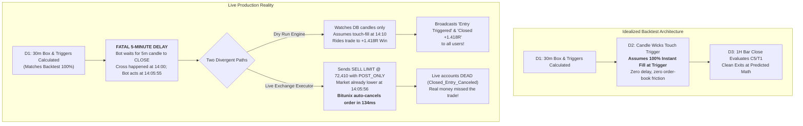

# LIVE OPERATIONS & SYSTEM PARITY FORENSIC AUDIT
## Comprehensive Breakdown of Nov 12, 2026 Trading Incidents, D1-D2-D3 Architectural Divergence, and Code Directives for Claude Code (CC)

**Date:** 2026-11-12  
**Author:** Antigravity / DeepSeek (Brain R&D & Quantitative Audit)  
**Target Repositories:** `KTBB_app_v2` (Live Site) · `Kabroda AI Brain` (R&D / CANON)  
**Audited Components:** `traveler_plans`, `executor_live_e1_engine.py`, `traveler_plan_engine.py`, `traveler_plan_notify.py`, `cme_risk.py`, `cme_order_engine.py`, `executor_accounts`, `email_send_log`, `executor_audit_log`  
**Governing Rules:** Zero-Memory Rule, Single Handoff Trail, Parity Invariant (§0 Master Spec).

---

## 1. Executive Summary: What Actually Happened Today (2026-11-12)

Today produced a severe operational disconnect that fully explains Andy's frustration:
1. **Bitcoin Traveler (Plan 57):** The strategy identified a valid SHORT breakdown at `$72,410.00`. The dry-run simulation captured a **+1.418 R profit (+$70.90)** via C5 exhaustion at `$71,609.90`. However, **all three real-money LIVE accounts (Andy #1, Dawson #11, Terry #15) were CANCELED by Bitunix within 134 milliseconds of submission** and made **$0.00**.
2. **The Notification Nightmare:** Subscribers and Andy were bombarded with contradictory messages:
   - At `14:06:05` UTC: An email saying *"traveler entry canceled on the exchange"*.
   - At `14:10:05` UTC: A broadcast email saying *"BTCUSDT SHORT - Entry Triggered @ 72,410"*.
   - At `15:00:58` UTC: A broadcast email saying *"BTCUSDT SHORT - Closed (+1.418R profit)"*.
   *The live accounts held no position, yet the system broadcasted entry and winning exit notifications based on the dry-run simulation.*
3. **CME Desk (Plans 17 & 18 - MNQ & MES):** Both symbols locked cleanly at 15:00 UTC (10:00 AM ET), but **all orders were instantly rejected**:
   - Live Account 17 (Andy MFFU): `REJECTED: NO_TRAILING_DD_LIMIT_CONFIGURED`
   - Dry Run Account 16: `REJECTED: EQUITY_QUERY_FAILED -- broker balance query failed`
   Subscribers received *"Session Locked, ARMED (CME)"* emails, but zero trades were placed.

---

## 2. Why the Live Site Diverges From Backtest Expectancy (The Root Cause)

Andy asked: *“Why can't the system match the expectancy of what the backtest basically said? We have D1, D2, and D3... why do we get different things happening all the time?”*

Here is the exact architectural truth:



### The Three Structural Divergences:

### A. D1 (Structure & Discovery): **PARITY INTACT (100% MATCH)**
- Backtest and Live both compute 30-minute calibration box, VAH/VAL/POC, triggers, and reachability gate identically.
- Today: Plan 57 locked at 14:00:32 UTC (`breakdown_trigger: 72,410.00`, `stop: 72,974.22`, `box: 564.22`). Math was 100% accurate.

### B. D2 (Confirmation & Entry): **FATAL ARCHITECTURAL DIVERGENCE**
1. **The 5-Minute Bar Close Delay:**
   - In backtest (`lab_touchfill_arms.py`), a trade is assumed filled the moment the trigger is touched.
   - In live site, `traveler_plan_engine.py` waits for the 5m candle to **close** (`cross_time = 14:00`, closed at `14:05`). The executor does not fire until `14:05:55`.
2. **The Limit Order & `POST_ONLY` Rejection Paradox:**
   - At `14:05:55`, the engine calls `client.place_order(price="72410.0", side="SELL", order_type="LIMIT", effect="POST_ONLY")`.
   - But by `14:05:55`, Bitcoin had already broken down to ~`$72,390`.
   - On Bitunix, sending a `SELL LIMIT` order at `72,410.00` when the market is below `72,410.00` either cannot rest, or when price wicks, Bitunix evaluates it as a taker order. Because `POST_ONLY` strictly forbids taking liquidity, Bitunix immediately canceled the order!
   - Bitunix response in `executor_audit_log`:
     `{'orderId': '2120880775104331776', 'side': 'SELL', 'orderType': 'LIMIT', 'effect': 'IOC', 'status': 'CANCELED'}`.
   - The exchange converted/treated it as Immediate-Or-Cancel (IOC) and killed it within 134 milliseconds.
3. **The Simulation Split:**
   - Real money accounts were killed at `14:06:06`.
   - But `traveler_plan_engine.py` (which powers DRY RUN) does not talk to the exchange. At `14:10:05`, it saw the candle range touched `72,410` and marked `FILLED`.
   - Dry run got filled; Live got canceled.

### C. D3 (Management & Exits): **INTACT, BUT DESYNCHRONIZED**
- Yesterday Andy asked: *Did the C5 fix ruin the other things we've been trying to build?*
- **NO.** C5 worked flawlessly today. At 15:00:54 UTC, the 1H Wilder RSI dropped, triggering `C5_EXIT` on the dry-run position at `71,609.90` for **+1.418 R**.
- The C5 logic is completely sound. The problem is that **Live accounts were already dead at 14:06**, so they never reached D3.

---

## 3. Forensic Audit of Today's Orders & Database Records

### Traveler Plan 57 (BTC/USDT) Ledger:
* **Trigger:** `72,410.00` | **Stop:** `72,974.22` | **T1:** `70,443.18`
* **Live Orders:**
  * Order `6063` (Andy Acct #1, 30x): Placed `14:05:56` -> Bitunix Cancel `14:05:56.440` -> `CLOSED_ENTRY_CANCELED` at `14:06:09`.
  * Order `6064` (Dawson Acct #11, 35x): Placed `14:05:56` -> Bitunix Cancel `14:05:56.440` -> `CLOSED_ENTRY_CANCELED` at `14:06:06`.
  * Order `6065` (Terry Acct #15, 10x): Placed `14:05:57` -> Bitunix Cancel `14:05:57.210` -> `CLOSED_ENTRY_CANCELED` at `14:06:07`.
* **Dry Run Orders:**
  * Order `6066` (Acct #12): Opened `14:10:05` @ `72,410.00` -> Closed `15:00:54` @ `71,609.90` on `C5_EXIT` (+1.4181 R / +$70.90).
  * Order `6067` (Acct #14): Opened `14:10:05` @ `72,410.00` -> Closed `15:01:02` @ `71,609.90` on `C5_EXIT` (+1.4181 R / +$70.90).

---

## 4. Forensic Audit of CME Desk Rejection (Plans 17 & 18)

### The Smoking Gun:
Last night (2026-11-11 late night, commit `c0868f7`), Claude Code implemented trailing drawdown enforcement in `cme_risk.py`:
```python
# cme_risk.py:80-85
limit = account.trailing_drawdown_limit_usd
if limit is None or limit <= 0:
    return {
        "ok": False, "reason": "NO_TRAILING_DD_LIMIT_CONFIGURED",
        "drawdown_usd": None, "buffer_remaining_usd": None, "warn": True,
    }
```
**Database Inspection of `executor_accounts`:**
* Account `17` (`Andy_CME_Funds`, LIVE, MFFU $50k):
  * `trailing_drawdown_limit_usd`: **`NULL`**
  * `high_water_mark_usd`: **`NULL`**
* Account `16` (`Andy_CME`, DRY_RUN):
  * `trailing_drawdown_limit_usd`: **`NULL`**

**Result at 15:00 UTC Today:**
- When `cme_order_engine.py` evaluated Account 17, `limit` was `None`. The risk engine strictly failed-closed and **rejected all 4 live orders** (`NO_TRAILING_DD_LIMIT_CONFIGURED`).
- For dry run Account 16, the engine attempted a live broker balance query on an account with no Tradovate API credentials, throwing `EQUITY_QUERY_FAILED`.
- Zero CME trades could be placed.

---

## 5. Notification & Alert Subsystem Forensic Audit

Andy noted: *“The notifications that are going out, they're inconsistent, they don't make sense... I can't even tell what half of them are.”*

### The Inconsistency Chain (from `email_send_log`):
1. `14:00:03` UTC: `BTCUSDT - No Re-arm Trade` sent to 3 subscribers.
2. `14:00:34` UTC: `BTCUSDT - Levels Locked` sent to 3 subscribers.
3. `14:06:05` UTC: `KABRODA EXECUTOR ALERT -- traveler entry canceled on the exchange (BTC/USDT)` sent to Andy.
4. `14:06:07` UTC: Same cancel alert sent to Terry.
5. `14:06:09` UTC: Same cancel alert sent to Dawson.
6. `14:10:05` UTC: `BTCUSDT SHORT - Entry Triggered @ 72,410` sent to all 3 subscribers.
7. `15:00:05` UTC: `MNQ - Session Locked, ARMED (CME)` sent to all 3 subscribers.
8. `15:00:08` UTC: `MES - Session Locked, ARMED (CME)` sent to all 3 subscribers.
9. `15:00:58` UTC: `BTCUSDT SHORT - Closed (momentum-decay exhaustion (C5) exit) @ 71,610` sent to Andy.
10. `15:01:00` UTC: `BTCUSDT SHORT - Re-arm Watch` sent to all 3 subscribers.

### Why this happens:
- **Flaw 1 (Simulation Masquerading as Reality):** Broadcast emails (`send_broadcast_email`) listen to `TravelerPlan` state changes. The plan transitions to `FILLED` whenever the *dry-run candle simulator* detects a touch, **even if all real live exchange orders were canceled 4 minutes earlier**.
- **Flaw 2 (Premature ARMED Notifications):** CME sends "Session Locked, ARMED" broadcast emails before the risk engine evaluates `cme_risk.py`. Subscribers are told the session is ARMED, only for the orders to be rejected 1 second later with no follow-up explanation.
- **Flaw 3 (Telegram / Email Desync):** Account-level alerts (like order cancels) go only to individual email addresses, while trade triggers go to the broad broadcast list and Telegram bot. This creates a state where the Telegram bot announces a live trade that the user's personal account was just locked out of.

---

## 6. Actionable Work Order & Questions for Claude Code (CC)

CC must not guess or write pleaser responses. We require clean, code-verified answers and fixes for the following:

### Work Item 1: D2 Entry Order Mechanics (`executor_live_e1_engine.py`)
* **Question for CC:** Why are we sending `effect="POST_ONLY"` on a breakdown LIMIT order *after* waiting 5 minutes for a bar close? If price is already below `$72,410.00`, a sell limit order cannot rest as a maker order unless price bounces back up. Bitunix explicitly converts or rejects this as IOC.
* **Required Fix:** 
  1. Determine the exact order execution model: Should live entries be **MARKET orders upon confirmed 5m bar close**, or **resting STOP-MARKET / STOP-LIMIT orders placed at the trigger ahead of time**?
  2. If the spec demands maker-only limits, why does the dry-run engine assume a fill when the live exchange order was rejected? DRY RUN and LIVE must have identical fill criteria.

### Work Item 2: Fix CME Account 17 Database State & Guard (`cme_risk.py`)
* **Question for CC:** In `cme_risk.py`, trailing drawdown was made a hard blocker, but `executor_accounts` was never seeded with limits for Account 17.
* **Required Fix:**
  1. Execute DB migration / update to set `trailing_drawdown_limit_usd = 2500.00` and `high_water_mark_usd = 50000.00` for Account 17 (`Andy_CME_Funds`).
  2. In `cme_risk.py` / `cme_order_engine.py`: Handle `DRY_RUN` accounts (Account 16) gracefully so that lack of live Tradovate API credentials does not throw `EQUITY_QUERY_FAILED` and block simulation testing.

### Work Item 3: Notification Layer Decoupling (`traveler_plan_notify.py`)
* **Required Fix:**
  1. Broadcast emails (*"Entry Triggered"*, *"Closed @ Profit"*) must check whether **any LIVE account actually holds an open position**. If all live accounts had their entries canceled, the system must NOT broadcast a successful entry email to subscribers.
  2. Clearly tag dry-run notifications as `[SIMULATION / DRY RUN]` if sent, or suppress broadcast emails when no live execution occurred.
  3. CME ARMED emails must only send after `cme_risk.py` passes and orders are successfully transmitted.

---

*Authored by Antigravity / DeepSeek. Committed to project roots for CC execution.*
