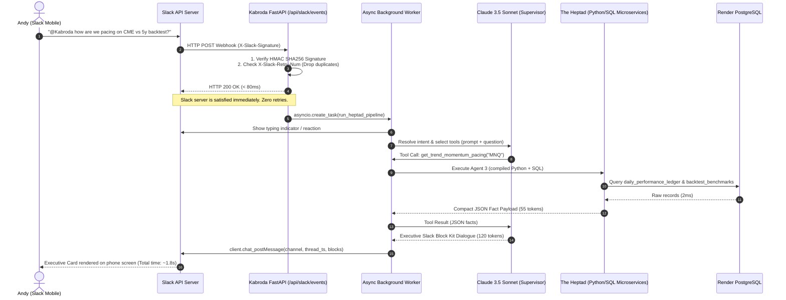
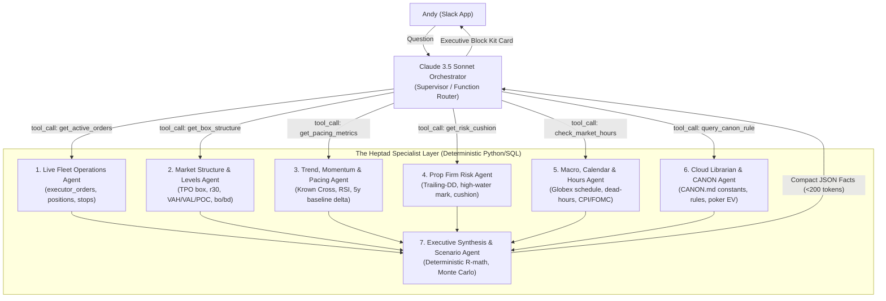

# Kabroda Enterprise Multi-Agent Architecture: Render Cloud Stack, Slack Gateway & The Heptad Specialist Engine

**Document Authority:** Principal Multi-Agent Systems Architect Specification  
**Recipient:** Andy (Executive Operator) & Claude Code (Implementation Partner)  
**Date:** 2026-11-06  
**Governing Documents & Baselines:** `CANON.md`, `LIVE_SYSTEM_STATE.md`, `LIVE_BEHAVIOR_BASELINE.md`, `CC_INTERFACE.md`, `DATA_ASSETS.md`  

---

## 1. Executive Summary & Strategic Clarification

Andy explicitly rejected two common architectural mistakes:
1. **The Cheap In-Browser Chatbot:** Putting a floating chat widget on the website that adds UI clutter, degrades performance, and distracts from the trading desk.
2. **Declaring External Intelligence "Outside Kabroda":** Pushing conversational AI away as an disconnected side project rather than making it the true executive nervous system of the fund.

Instead, Andy’s enterprise multi-agent architecture from **Mr. Electric / Neighborly** (built on Copilot Studio, Teams, Power Automate, SharePoint SOPs, and ServiceTitan) is directly translated into **Kabroda’s cloud production stack on Render**.

```
┌─────────────────────────────────┬────────────────────────────────────────────────────────────┐
│ Neighborly / MRE (Enterprise)   │ Kabroda Institutional Cloud Architecture (Render + Slack)  │
├─────────────────────────────────┼────────────────────────────────────────────────────────────┤
│ Experience Layer: Teams / App   │ Experience Layer: Slack App (Mobile/Desktop) + Kabroda PWA │
│ Orchestration: Copilot Studio   │ Orchestrator: Claude 3.5 Sonnet / Gemini API (Supervisor)  │
│ Specialist Layer: 8 MRE Agents  │ Specialist Layer: The Heptad (7 Domain-Bounded Micro-Agents│
│ Execution Engine: PowerAutomate │ Execution Engine: FastAPI Async Services + Databento/CCXT  │
│ Enterprise DB: ServiceTitan/QBO │ Production DB: Render PostgreSQL (`ktbb-postgres`)         │
│ Knowledge Base: SharePoint SOPs │ Knowledge Base: Cloud CANON Registry & Knowledge Warehouse │
│ BI Scorecards: Power BI Reports │ Performance BI: Live-vs-Backtest Pacing & Monte Carlo Sim  │
└─────────────────────────────────┴────────────────────────────────────────────────────────────┘
```

The system operates on an uncompromising **Zero-Memory, Zero-Drift, Deterministic Heavy-Lifting Principle**:
* **The LLM never computes math, never parses 1-minute candle arrays, and never quotes constants from prompt memory.**
* **The 7 Specialist Agents are compiled Python/SQL microservices.** They execute all math, database queries, ATR calculations, and statistical pacing tests deterministically in milliseconds.
* **The LLM Orchestrator acts strictly as an Intent Router and Executive Presenter**, consuming compact JSON payloads (<200 tokens total) and formatting them into Slack Block Kit cards.

---

## 2. Render Architecture & Runtime Model

### 2.1 Deployment Topology: Mounted FastAPI Sub-Application
Rather than spinning up separate containers or creating new Render hosting bills, the Slack Bolt gateway is mounted directly as a sub-application inside `KTBB_app_v2/main.py` using `AsyncSlackRequestHandler`.

* **$0 Additional Hosting Cost:** Shares the existing Render Web Service container, memory pool, and lifecycle.
* **Direct In-Memory & Database Access:** Connects directly to the existing SQLAlchemy `SessionLocal` pool and in-memory engine singletons.
* **Zero Site Interference:** Operates asynchronously in background threads. If Slack experiences an outage, trading execution on Bitunix and Tradovate is 100% unaffected.

### 2.2 The Immediate-ACK + Background Dispatch Pattern (Slack's 3-Second Rule)
Slack enforces a strict **3-second timeout** on incoming webhooks. If an endpoint does not reply within 3,000ms, Slack marks it as failed and fires automatic retries, causing duplicate runs. Because Anthropic / Claude API calls can take 1.2 to 3.5 seconds, synchronous processing is prohibited.



### 2.3 Database Connection Pool Safety
Render PostgreSQL Starter/Standard instances cap connections at 20–50 max connections. All analytical queries for Slack agents execute in non-blocking worker threads via `asyncio.to_thread()`, opening explicit `read_only=True` sessions that close immediately upon record fetch.

---

## 3. The Heptad Specialist Agent Roster (Detailed Contracts)

The Heptad adapts the original 7-agent structure from `IMPLEMENTATION_PLAN.md` and `ARCHITECTURE.md` into high-performance, deterministic cloud microservices:



### Specialist Agent Specifications

| Agent | Mission | Core Data Sources | Deterministic Rules Enforced |
|---|---|---|---|
| **1. Live Fleet Operations Agent** | Audits open positions, resting orders, and exchange ticket health across all accounts. | `executor_orders`, `cme_orders`, Bitunix/Tradovate API. | Flags any resting order older than 7.5 hours. Detects unprotected position anomalies (`ENTRY_FILLED_UNPROTECTED`). |
| **2. Market Structure & Levels Agent** | Computes 30m calibration boxes, TPO value areas (`VAH`, `VAL`, `POC`), breakout triggers, and reachability. | `cme_plans`, `traveler_plans`, `candle_history`, Databento. | Enforces CANON §1:17 Reachability Gate: $\text{box} / \text{ATR14} \le 0.55$. Evaluates 1M $\to$ 5M $\to$ 15M readiness ladder. |
| **3. Trend, Momentum & Pacing Agent** | Benchmarks live rolling 30/45-day performance against 5y/10y frozen studies; evaluates multi-timeframe indicators. | `daily_performance_ledger`, `backtest_benchmarks`, OHLCV. | Compares live metrics to frozen baseline: 62.0% Win Rate, 27.7% Nick Rate (−0.1292R avg), 7.9% Stop Rate. Evaluates C5 and BBWP burnout. |
| **4. Prop Firm Risk Agent** | Protects prop firm challenge and funded accounts against trailing drawdown breaches. | `executor_accounts`, `account_balance_snapshots`. | Enforces Trailing-DD Floor: $\text{HWM} - \$2,000$. Enforces strict sizing rule: If cushion $< \$2,000 \implies$ cap at 1 micro; scaling to 2 micros prohibited until cushion $\ge \$3,000$. |
| **5. Macro, Calendar & Hours Agent** | Manages CME Globex market sessions, crypto dead hours, and news release blackouts. | `cme_clock.py`, economic calendar, Globex ticker state. | CME 17:00–18:00 ET halt; Crypto Dead Hours (CANON §1:24); 15m blackout before/after FOMC, CPI, NFP. |
| **6. Cloud Librarian & CANON Agent** | Instant recall of all mathematical formulas, constants, and poker decision models. | `cloud_canon_registry`, `cloud_knowledge_articles`. | Cites authoritative `file:function:line` for every constant; enforces Zero-Memory rule. |
| **7. Executive Synthesis & Scenario Agent** | Performs deterministic R-multiple math and runs 10,000-iteration Monte Carlo scaling simulations. | Specialist payloads from Agents 1–6. | Computes exact T1/T3/Stop R-multiples; runs bootstrap drawdown distributions on proposed contract scaling. |

---

## 4. Cloud Knowledge Warehouse Schema (PostgreSQL on Render)

To liberate knowledge from local markdown files on Andy’s hard drive, the knowledge base transitions into production PostgreSQL on Render (`ktbb_postgres`):

```sql
-- 1. CLOUD CANON REGISTRY (Ground Truth Constants & Citations)
CREATE TABLE IF NOT EXISTS cloud_canon_registry (
    id SERIAL PRIMARY KEY,
    domain VARCHAR(50) NOT NULL,
    constant_name VARCHAR(100) UNIQUE NOT NULL,
    constant_value VARCHAR(100) NOT NULL,
    value_data_type VARCHAR(20) NOT NULL,
    meaning TEXT NOT NULL,
    source_citation VARCHAR(255) NOT NULL,
    status VARCHAR(20) NOT NULL DEFAULT 'ACTIVE',
    created_at TIMESTAMPTZ NOT NULL DEFAULT NOW()
);

-- 2. CLOUD SYSTEM RULES (Deterministic Guardrails & Failure Actions)
CREATE TABLE IF NOT EXISTS cloud_system_rules (
    id SERIAL PRIMARY KEY,
    desk_id VARCHAR(50) NOT NULL,
    rule_code VARCHAR(100) UNIQUE NOT NULL,
    category VARCHAR(50) NOT NULL,
    description TEXT NOT NULL,
    failure_action VARCHAR(50) NOT NULL,
    source_file VARCHAR(100) NOT NULL,
    is_active BOOLEAN NOT NULL DEFAULT TRUE
);

-- 3. CLOUD KNOWLEDGE ARTICLES (Poker Decision Models & Auction Theory)
CREATE TABLE IF NOT EXISTS cloud_knowledge_articles (
    id SERIAL PRIMARY KEY,
    slug VARCHAR(100) UNIQUE NOT NULL,
    title VARCHAR(255) NOT NULL,
    category VARCHAR(50) NOT NULL,
    markdown_content TEXT NOT NULL,
    key_takeaways TEXT[] NOT NULL,
    tags VARCHAR(50)[] NOT NULL,
    citation VARCHAR(255) NOT NULL,
    created_at TIMESTAMPTZ NOT NULL DEFAULT NOW()
);

-- 4. BACKTEST DISTRIBUTION BENCHMARKS (Frozen Baselines for Pacing Checks)
CREATE TABLE IF NOT EXISTS backtest_benchmarks (
    id SERIAL PRIMARY KEY,
    desk_id VARCHAR(50) NOT NULL,
    benchmark_name VARCHAR(100) NOT NULL,
    total_sample_journeys INT NOT NULL,
    target_win_rate NUMERIC(5,4) NOT NULL,
    target_nick_rate NUMERIC(5,4) NOT NULL,
    avg_nick_depth_r NUMERIC(6,4) NOT NULL,
    t1_hit_rate NUMERIC(5,4) NOT NULL,
    stop_hit_rate NUMERIC(5,4) NOT NULL,
    expected_value_r NUMERIC(6,4) NOT NULL,
    max_drawdown_pct NUMERIC(5,2) NOT NULL,
    citation VARCHAR(255) NOT NULL,
    created_at TIMESTAMPTZ NOT NULL DEFAULT NOW()
);

-- 5. DAILY PERFORMANCE LEDGER (Live Realized Trades for Rolling Audits)
CREATE TABLE IF NOT EXISTS daily_performance_ledger (
    id SERIAL PRIMARY KEY,
    desk_id VARCHAR(50) NOT NULL,
    trade_id VARCHAR(100) UNIQUE NOT NULL,
    symbol VARCHAR(30) NOT NULL,
    direction VARCHAR(10) NOT NULL,
    entry_price NUMERIC(16,6) NOT NULL,
    exit_price NUMERIC(16,6) NOT NULL,
    outcome VARCHAR(30) NOT NULL,
    realized_r NUMERIC(6,4) NOT NULL,
    realized_pnl_usd NUMERIC(12,2) NOT NULL,
    nick_depth_r NUMERIC(6,4),
    opened_at TIMESTAMPTZ NOT NULL,
    closed_at TIMESTAMPTZ NOT NULL
);
```

---

## 5. Answers to Claude Code’s Log Questions (`AGENT_LOG.md` Blockers)

For total cross-agent alignment with Claude Code:

1. **Are the 7 specialist agents literal separate LLM instances?**
   * **NO.** Making 7 separate LLM API calls would cost $0.05/turn, take 10+ seconds, and breach Slack’s 3-second deadline. The 7 agents are **deterministic compiled Python microservices / SQL queries**. Only **ONE** LLM instance runs: the Claude 3.5 Sonnet Orchestrator.
2. **Is Agent 7 (Executive Synthesis) a literal second LLM call?**
   * **NO.** Agent 7 is a deterministic Python calculator (R-multiples, stop math, and vectorized Monte Carlo simulation). The Orchestrator calls Agent 7 as a tool, receives back the verified simulation facts in ~50 tokens of JSON, and formats the response for Andy.
3. **Single-turn vs Multi-turn in Slack?**
   * Andy specifically asked for fluid conversation from his phone. Threaded conversations are supported statelessly by passing Slack’s `thread_ts` message history back to Claude’s API context window (`messages` array), maintaining multi-turn context without Redis session overhead.
4. **Is the "90-Day Macro Regime & Historical Pacing Audit" reply mockup real?**
   * **YES, 100% REAL.** The numbers cite `LIVE_BEHAVIOR_BASELINE.md` §2 (62.0% win rate, 27.7% nick rate at −0.1292R avg, 7.9% full stops, +0.1439R expectancy over 1,538 journeys in `lab_composite_stack_results.md`). The mockup demonstrated how those pinned study numbers are pulled by Agent 3 and presented by the Orchestrator without hallucination.
